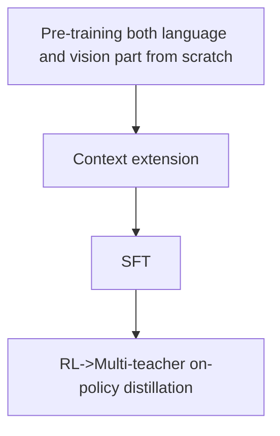

## Kimi K3: Training vision encoder from scratch for native multimodal capability

### Vision Architecture and Attention

Kimi K3 adopt LLaVA-style vision encoder(MoonViT-V2) + LLM to handle visual inputs.

**MoonViT-V2** is a 27-layer, 401M-parameter ViT, trained **from scratch** with RMSNorm and bias-free projections for stability. It shares parameters across images and videos and supports spatiotemporal attention. Two operations compress visual tokens before the MLP projector:

- Temporal pooling (4×): Groups four consecutive video frames and averages their encoded features at corresponding spatial positions, reducing \(T=4\) to \(T=1\).

- 2×2 pixel shuffle (4×): Concatenates four neighboring spatial tokens along the channel dimension, transforming \((H,W,C)\rightarrow(H/2,W/2,4C)\).
Together, they provide up to 16× token reduction for four-frame video chunks, enabling high-resolution inputs (up to 3584×3584) within K3's 1M-token context.

Two types of attention mask appear here: 
1) For video/image, intra-frame spatial attention and inter-frame temporal attention happen in the vision encoder. According to official implementation, the actual behavior is just full bidirectional attention for vision, which means each token within the video can attend to every tokens within that video. So, I guess that's just a compromise on infra because block-causal mask(causal between frames and bidirectional within each frame) might require extra engineering? 

2) After projection into LLM, all tokens are packed into a single unified sequence where only causal attention is used. Note that bidirectional interaction already happens within vision encoder so this does not prevent temporal-spatial interaction.

My question is, since vision encoder has already done the bidirectional interaction, do we really need the LLM to do attention between visual tokens again which is really expensive? Even more aggresively, we can consider totally freezing vision hidden features so that they remain unchanged between layers and work solely as KV memory.

### Training Paradigm and Recipe

